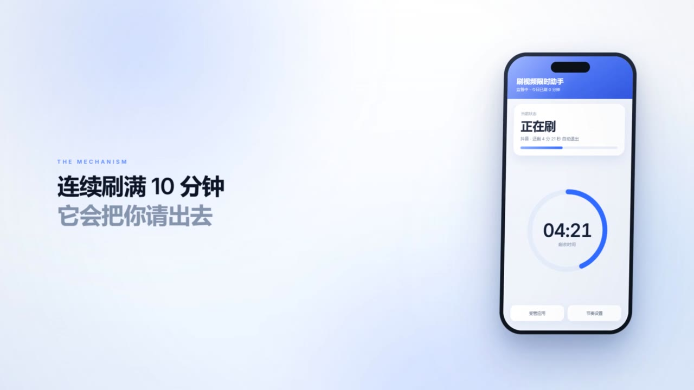

# 刷视频限时助手

> 短视频不需要被限时，需要的是**一段一段的休息**。

一个用「节奏」而不是「额度」来打断无意识刷视频的安卓应用。连续刷满设定时长，它会把你请出去；接下来的几分钟里，你再点开也会被立刻送出来。休息结束，重新计时。

<p align="center">
  
</p>



## 为什么不是「每日限额」

市面上的屏幕时间工具几乎都在算一笔账：今天还剩多少分钟额度。问题是额度会**制造冲刺**——"还剩 20 分钟，赶紧多刷会儿"，结果反而助长了一次更长的连续使用。

这个应用换了一个模型：不统计你一天总共看了多久，只关心**你已经连续看了多久**。到点就打断，休息完再开始。它不评判你，只是替你踩刹车。

| 每日限额 | 连续节奏（本项目） |
| --- | --- |
| 额度用完就锁死，容易引发逆反 | 每段结束都有明确的休息终点 |
| 越接近上限越焦虑，容易冲刺 | 分段固定，不需要盘算还剩多少 |
| 一整天只有一个数字 | 每次都是一次干净的重新开始 |

## 功能

- **间隔自动退出**：连续刷满 N 分钟（默认 10，可调 1–120），自动退出当前应用
- **退出方式可切换**：返回键优先（一层层退出去）或直接回桌面
- **导航方式适配**：自动识别三键导航 / 全面屏手势，也可手动指定；两者都能退出，切换只影响判定时序
- **强制休息**：退出后进入 M 分钟冷却（默认 2，可调 1–30），期间重开会立刻又被请出
- **连续计时**：短暂切出去回条消息（≤20 秒）不会重置，真正离开才算断开
- **前台监督**：后台每秒检查前台应用，进程被杀自动恢复，支持开机自启
- **轻提示**：有悬浮窗权限时，退出瞬间顶部飘一张卡片（2.5 秒，不拦截触摸）
- **7 天趋势**：只作回顾，不参与锁定

## 快速开始

1. 到 [Releases](../../releases) 下载最新的 `刷视频限时助手-vX.X.apk`
2. 安装（首次需允许「安装未知应用」）
3. 打开应用，按首页提示授权：**无障碍**（必需）、**使用情况访问**（必需）、悬浮窗（可选）
4. 在「受管应用」里勾选抖音、快手、B 站等
5. 打开「监督服务」开关

> 想快速验证：把间隔和休息都调成 1 分钟，试两轮再调回正常值。

## 从源码构建

### 方式一：命令行脚本（无需 Gradle，约 40 秒出包）

```bash
cd VideoLimitApp
./build_apk.sh
```

依赖：JDK 17+、Android SDK（`platforms;android-34` + `build-tools;35.0.0`）。
脚本会自动从 `JAVA_HOME` 或 PATH 里的 `javac` 找 JDK，从 `ANDROID_HOME` 或工程旁的 `android-sdk/` 找 SDK。

> 说明：`build-tools` 必须用 **35+**。34 版本的 `d8` 处理 JDK 21 编译出的匿名内部类会崩溃，这是本项目实际踩过的坑。

### 方式二：Android Studio

直接打开 `VideoLimitApp/` 目录，Gradle 配置已就绪（AGP 8.x）。首次打开需在 `local.properties` 里填 `sdk.dir`。

## 项目结构

```
.
├── VideoLimitApp/           安卓应用（Java，无第三方依赖）
│   ├── app/src/main/java/com/videolimit/app/
│   │   ├── LimitService.java      监督服务：连续会话 + 冷却期状态机
│   │   ├── HomeKeyService.java    无障碍服务：performGlobalAction 退出应用
│   │   ├── RestOverlay.java       休息提示卡片
│   │   ├── MainActivity.java      首页：状态卡与节奏设置
│   │   └── ...
│   ├── build_apk.sh              一键构建（aapt2 → javac → d8 → zipalign → apksigner）
│   └── README.md                 应用详细说明（权限、原理、构建）
├── PromoVideo/              宣传片工程（纯代码渲染，非 AI 生成）
│   ├── film.html                 42 秒动画本体，浏览器打开即循环播放
│   ├── render.js                 Chrome 逐帧截取 → ffmpeg 编码
│   └── music.py                  原创配乐合成（numpy 加法合成）
└── docs/images/             README 配图
```

## 权限与隐私

这个应用申请了三个敏感权限，逐项说明实际用途：

| 权限 | 系统层面的能力 | 本应用的实际行为 |
| --- | --- | --- |
| 使用情况访问 | 读取所有应用的打开记录与时长 | 只判断当前前台应用与连续停留时长 |
| 无障碍服务 | 读屏幕文字、模拟点击、操作任意应用 | `canRetrieveWindowContent=false`，只订阅窗口切换事件，唯一动作是 `performGlobalAction`（返回 / 回桌面） |
| 悬浮窗 | 在任何界面之上绘制 | 只在退出瞬间显示 2.5 秒卡片，且设置 `FLAG_NOT_TOUCHABLE`，点不动 |

**最关键的一条：应用没有申请 `INTERNET` 权限。** 在 Android 权限模型下，没有网络权限的进程在内核层面就无法建立 TCP 连接——数据不是"承诺不上传"，而是物理上出不去。所有记录只存在本机 SharedPreferences 里。

代码全部可审阅：`VideoLimitApp/app/src/main/java/`。

## 宣传片

`PromoVideo/` 是一支 42 秒、1080p 的产品片，全部由代码逐帧渲染——不是 AI 生成视频，所以每个字、每个像素都在控制之内。

```bash
cd PromoVideo
npm install                       # 安装 puppeteer-core / ffmpeg / Inter 字体
node render.js --test             # 先渲染 14 张关键帧看效果
node render.js --all              # 全量 1260 帧并编码为 MP4
python music.py                   # 合成 42 秒原创配乐（需要 numpy）
```

成片不入库（体积原因），可在 Releases 中下载。

## 已知限制

- **微信视频号无法单独限制**：它在微信内部，按应用维度拦不到，需要微信自带的青少年模式。
- **必须开无障碍**：Android 没有向普通应用开放"关闭其他应用"的接口，`performGlobalAction` 是免 root 下唯一稳定手段。不开无障碍，应用退化为"只统计不打断"。
- **部分国产 ROM 会杀后台**：需要在系统设置里给本应用「自启动」和「后台运行」权限，否则监督服务可能被清理。
- 仅适配 Android 7.0（API 24）及以上。

## 免责声明

本项目是一个自用的自律工具，通过系统无障碍能力帮助用户按自己的设定退出应用。它不收集、不上传任何数据，也不绕过任何应用的使用条款。请自行评估在你设备上开启相关权限的风险。

## License

[MIT](LICENSE)
